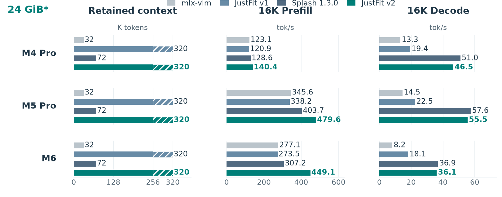

<div align="center">
  <picture>
    <source media="(max-width: 600px)" srcset="docs/assets/justfit-banner-mobile.svg">
    
  </picture>

  [](https://test.pypi.org/project/justfit-llm/2.3.0rc24/)
  [](LICENSE)

  **[开始使用](#开始使用) · [实测结果](#实测结果) · [文档导航](#文档导航) · [English](README.md)**
</div>

JustFit 面向内存受限的 Mac，协调压缩上下文、常驻推测 draft、并发请求及 CPU/GPU/ANE，运行 **27B 语言与视觉模型**。所有计算共享同一份统一内存预算。

**公开测试版：`2.3.0rc24`。** [源码](https://github.com/YuhuaBillChen/justfit-llm/tree/v2.3.0rc24)和 [TestPyPI 包](https://test.pypi.org/project/justfit-llm/2.3.0rc24/)已发布。本测试版在本机编译原生程序；签名的预编译程序和按芯片区分的 ANE 下载正在准备。正式 PyPI `2.3.0` 尚未发布，论文仍在修订。

## JustFit 做什么

- **保留长历史，也保留 draft。** warm-prefix 实验在两条同时存活的请求中达到 320K 聚合页容量，v2 保持推测 draft 常驻。这是 B2 已测容量，不是单请求 320K 或冷启动 prefill 的保证。
- **让并发有空间。** 限制临时工作区、共享压缩页，在调度、持久化和冷重启间保留已提交的复合状态。
- **让空闲加速器接活。** M4 Pro 使用 CPU 辅助 prefill，M5 Pro/M6 使用 GPU A8，并在阶段和内存允许时使用 ANE。视觉卸载旨在把 GPU 留给文本，不保证每张图更快。
- **提供熟悉的接口。** OpenAI 兼容聊天、图像、流式输出、结构化输出，以及原生执行的 thinking budget 硬限制。

## 实测结果

<a href="docs/assets/system-comparison.png"></a>

**容量和速度来自独立实验。** 实心柱是已测 B1 边界，斜线延伸到单独测量的 B2 总量。v1/v2 按各自 warm-prefix 协议均达到 320K 页容量；v2 的 draft 常驻。速度采用八道固定 SPEED-Bench 16K 题，每题强制输出 512 token；权重格式、decoder 和设备配置不同。M4 Pro/M5 Pro 是物理 24 GiB；M6 是物理 32 GiB，仅 v1/v2 的 B2 容量测试锁住 8 GiB，速度测试使用物理 32 GiB。

在这些配置的 16K 实验中，v2 的 decode 中位速度为 v1 的 **2.0–2.5 倍**；相对上游 Splash 1.3.0，prefill 提升 **9–46%**，单路 decode 下降 **2–9%**。这是完整系统对比，不能当作单机制收益或芯片代际排名。

[完整协议、速度和限制 →](docs/RESULTS.md)

## 开始使用

### 环境

- **Apple silicon、macOS 27.0+、至少 24 GiB。** 参考配置为 M4 Pro、M5 Pro、M6，其他芯片变体没有逐一验收。
- 推荐 **Python 3.12**；包声明兼容 Python 3.12–3.14。
- 源码测试版需要兼容的 **Xcode/CoreAI SDK 与 Metal 编译工具链**。`justfit serve` 会查找已安装工具，不会替你安装 SDK。
- 固定模型包约 **17.4 GB**，还需为依赖、编译输出和缓存留空间；已检查的模型 revision 无需 Hugging Face token 即可访问。

Linux 可以安装 Python 工具，但不能运行这里的原生推理。独立 GPU 引擎的 macOS 26.4 源码目标不等于完整 Python/CoreAI 路径支持 26.4。

### 安装已测试版本

固定到测试版标签，建立独立环境。第三方依赖从正式 PyPI 安装，JustFit 单独从 TestPyPI 获取，避免混用依赖索引：

```bash
git clone --branch v2.3.0rc24 --depth 1 https://github.com/YuhuaBillChen/justfit-llm.git
cd justfit-llm
python3.12 -m venv .venv
source .venv/bin/activate

python -m pip install --index-url https://pypi.org/simple/ -r requirements-runtime.txt
python -m pip install --no-deps --index-url https://test.pypi.org/simple/ justfit-llm==2.3.0rc24
justfit verify
justfit doctor
justfit serve
```

首次运行会创建带版本的工作区、编译原生程序、下载并校验模型、选择设备预设，然后在 **`http://127.0.0.1:8000`** 提供服务。后续复用编译结果和模型；Ctrl+C 停止前台服务。没有视觉 ANE profile 时仍可使用 GPU 处理图像。

若缺少 Metal 编译器，在安装兼容 Xcode 后执行 `xcodebuild -downloadComponent MetalToolchain`。[Quickstart](QUICKSTART.md)介绍工具路径、端口、本地模型和预编译包参数。公开测试版以标签为准，`main` 的文档会继续更新。

### 发一个请求

```bash
curl http://127.0.0.1:8000/v1/chat/completions \
  -H 'Content-Type: application/json' \
  -d '{
    "model": "incoai/Qwen3.8-27B-Splash",
    "messages": [{"role": "user", "content": "17 乘以 19 是多少？"}],
    "max_tokens": 64,
    "reasoning_effort": "none"
  }'
```

模型 ID 保留上游运行时包的名称，程序与 CLI 品牌是 JustFit。默认权重 revision 为 `9d27070b71f7142c6b6025f03ac011d70a73cb48`。

## 四个机制

| 机制 | 作用 |
| --- | --- |
| **KVExec** | 以有界重建和旋转域注意力消费压缩历史。 |
| **PhaseSwap** | 管理组件和工作区生命周期，同时保持 draft 常驻。 |
| **StateTrans** | 在调度和持久化间保留已提交的 KV、循环状态和 draft 状态。 |
| **CrossFire** | 根据阶段所有权和内存准入协调 CPU、GPU 与 ANE。 |

### ANE 如何参与

| 参考预设 | 语言 prefill | 视觉 ANE 可用阶段 |
| --- | --- | --- |
| M4 Pro / `m4` | CPU 辅助 GPU | 文本 prefill 或 decode |
| M5 Pro / `m5` | GPU A8 | 文本 prefill 或 decode |
| M6 / `m6` | GPU A8＋ANE FFN | 无文本 prefill 的 decode 阶段 |

视觉 ANE 需要验收过的 4K/8K 资产、匹配的芯片/系统 build 和内存准入。**4K/8K 是图像 patch 数，不是文本 token 数或屏幕像素。** 空闲请求、不支持的输入或资源不足时用 GPU。M6 优先保证语言 ANE prefill。[ANE 下载与安装接口](docs/ANE_DOWNLOADS.md)。

## 文档导航

| 需求 | 文档 |
| --- | --- |
| 安装、构建、选端口和模型 | [Quickstart](QUICKSTART.md) · [Python 安装](docs/PYPI.md) |
| 看结果和验证范围 | [实验协议](docs/RESULTS.md) · [测试版验收摘要](docs/PREVIEW_VALIDATION.json) |
| 修改设备配置 | [配置](docs/CONFIGURATION.md) · [ANE 策略](ANE_POLICY.md) |
| 准备 ANE 与预编译运行时 | [ANE 安装](docs/ANE_DOWNLOADS.md) · [离线准备](docs/ANE_PROVISIONING.md) · [运行时分发](docs/RUNTIME_DISTRIBUTION.md) |
| 管理服务与接入 broker | [部署和回滚](docs/DEPLOYMENT.md) · [适配器](service/broker-integration/README.md) |
| 限制思考长度 | [Thinking budget](docs/THINKING_BUDGET.md) |
| 反馈和贡献 | [Issues](https://github.com/YuhuaBillChen/justfit-llm/issues) · [贡献指南](CONTRIBUTING.md) · [安全说明](SECURITY.md) |

默认仅监听本机。对外网络部署需要认证、TLS 和访问控制，见安全说明。`source/` 是原生运行时与前端，`vision-tools/` 是 ANE 工具，`service/` 是可选管理服务。

## 论文与引用

**JustFit v2: Long-Context Local LLM Serving with Just-in-Time State Management**，Yuhua Chen，2026。**[阅读预印本 PDF](https://github.com/YuhuaBillChen/justfit-llm/blob/paper-v2-2026-10-23-r2/paper/2026-10-23/JustFit-v2.pdf)** · [论文与引用文件](paper/README.md)。此日期版本会保留，论文可继续修订；arXiv 公开后再补链接。

如果 JustFit 对你的研究有帮助，请引用：

```bibtex
@unpublished{chen2026justfitv2,
  author = {Chen, Yuhua},
  title = {{JustFit v2}: Long-Context Local LLM Serving with Just-in-Time State Management},
  year = {2026},
  month = oct,
  note = {Preprint, version 2026-10-23 revision 2},
  url = {https://github.com/YuhuaBillChen/justfit-llm/blob/paper-v2-2026-10-23-r2/paper/2026-10-23/JustFit-v2.pdf}
}
```

[机器可读引用信息](CITATION.cff) · [JustFit v1 论文](https://arxiv.org/abs/2609.17475)

## 致谢与许可证

JustFit 原生运行时基于 **[Splash 1.3.0](https://github.com/incoai/splash)**。上游作者和实现贡献保留在 [NOTICE](NOTICE) 与[第三方声明](source/THIRD_PARTY_NOTICES)中。权重和衍生资产保留各自许可证。

代码采用 [Apache 2.0](LICENSE)。JustFit 的问题由本项目维护者处理，请向本仓库提交反馈。
